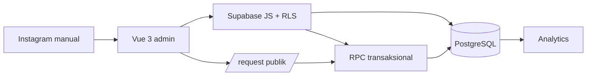

# PRD — IG Outreach & Referral Manager

Dokumen produk & operasional untuk modul internal di `jokitugasit-vue`.
Dokumen teknis (schema, RLS, migration, aturan uang) ada di
[`OUTREACH-CRM.md`](./OUTREACH-CRM.md).

- **Status:** MVP selesai, dalam tahap uji pasar
- **Pemilik:** solo engineer (tanpa tim sales/komunitas)
- **Stack:** Vue 3 + Vite + Supabase (PostgreSQL, Auth, RLS)
- **Bukan:** aplikasi baru, bot Instagram, atau agensi

---

## 1. Masalah

Klien berasal dari mahasiswa IT yang butuh bantuan teknis, tetapi:

1. Menemukan mereka secara manual di Instagram memakan waktu dan mudah
   terlewat.
2. Tidak ada tempat untuk mencatat siapa sudah dihubungi, siapa membalas, dan
   siapa menolak — riwayatnya tercecer di DM.
3. Program referral 10% sulit dijalankan tanpa cara mencatat atribusi dan
   komisi yang bisa diaudit.
4. Omzet dan komisi tidak bisa dihitung dari status "katanya sudah bayar".

**Tujuan:** satu dashboard kecil yang menutup rantai
`akun angkatan → prospek → DM → klien → proyek → pembayaran → komisi`,
tanpa menambah pekerjaan administratif.

## 2. Tujuan & non-goals

### Tujuan MVP

- Mendata akun angkatan/jurusan sebagai sumber prospek **berizin**.
- Mengimpor prospek dari daftar yang diberikan admin, dengan dedupe dan
  provenance.
- Menyiapkan DM manual (copy → buka Instagram → kirim sendiri).
- Mencatat respons dan mengubah prospek jadi proyek nyata.
- Mencatat DP/pelunasan/refund dan menghitung komisi 10% di database.
- Menampilkan funnel, omzet, dan sumber klien per periode/kampus.

### Non-goals (disengaja)

- Scraping followers/following akun pihak ketiga.
- Cold DM massal atau otomatisasi login Instagram.
- Payment gateway (pembayaran dicatat manual).
- Multi-tenant, portal mahasiswa, atau dashboard affiliate.
- Aplikasi/backend/auth/database kedua.
- Menjanjikan nilai akademik atau menyamarkan kepengarangan karya.

## 3. Pengguna

| Peran | Kebutuhan |
|---|---|
| Engineer (satu-satunya admin) | Prioritas prospek, riwayat kontak, angka uang yang benar |
| Admin angkatan (eksternal) | Diperlakukan sopan; memberi izin sebelum info dibagikan |
| Prospek / klien | Diproses lewat website, WhatsApp, dan form request |
| Partner referral | Kode unik, komisi transparan, tidak perlu mengerjakan proyek |

## 4. Ruang lingkup MVP (status implementasi)

| Kapabilitas | Status | Modul |
|---|---|---|
| Akun target + status izin | ✅ | `/ops/targets` |
| Prospek manual + import CSV + dedupe + DNC | ✅ | `/ops/prospects` |
| Audit batch import | ✅ | `import_batches` |
| Hapus prospek + suppression list | ✅ | `delete_prospect` |
| Antrean DM, template, copy, buka profil | ✅ | `/ops/outreach` |
| Log hasil kontak manual | ✅ | `outreach_logs` |
| Konversi prospek → proyek | ✅ | `create_request_from_prospect` |
| Proyek + quote + diskon + stack + kampus | ✅ | `/requests/:id` |
| Pembayaran DP/pelunasan/refund + void | ✅ | `/requests/:id` |
| Komisi 10% + status + bukti payout | ✅ | `/engineer/partners` |
| Analytics periode/kampus/sumber | ✅ | `/dashboard` |
| Portal partner (baca komisi sendiri) | ✅ | `/partner` |
| Feature flag modul | ✅ | `VITE_ENABLE_CRM` |
| Kode referral acak + rotasi | ✅ | `generate_referral_code`, tombol Ganti kode |
| Bucket lampiran privat + signed URL | ✅ | `migration-hardening.sql` |
| Import bertahap (chunk 200 baris) | ✅ | `import_prospects_batch` |
| Rate limit IP di edge | ⏳ fase 2 | butuh edge store; kode acak sudah membuat tebakan tidak praktis |
| Form publik tanya kampus | ⏳ opsional | `/request` |

## 5. User stories & acceptance criteria

1. **Sebagai engineer**, saya ingin mencatat akun angkatan beserta status izin.
   - Bisa tambah/edit/hapus; status `NEW/CONTACTED/PERMISSION_GRANTED/DECLINED`.
2. **Sebagai engineer**, saya ingin mengimpor daftar dari admin tanpa membuat
   duplikat dan tanpa menghidupkan kembali orang yang menolak.
   - Normalisasi `@`/huruf besar/spasi; duplikat dalam file & database dihitung;
     DNC tidak berubah; hasil per baris terlihat.
3. **Sebagai engineer**, saya ingin menyiapkan DM tanpa mengirim otomatis.
   - Preview terisi dari data nyata; placeholder kosong ditandai; tombol Copy +
     Open Instagram; tidak ada tombol bulk send.
4. **Sebagai engineer**, saya ingin mencatat respons dalam satu klik.
   - Status prospek berubah konsisten; prospek DNC hilang dari antrean.
5. **Sebagai engineer**, saya ingin mengubah prospek yang setuju jadi proyek.
   - Proyek baru terhubung (`prospect_id`), sumber `DIRECT_DM`, prospek
     `CONVERTED`, konversi ganda ditolak.
6. **Sebagai engineer**, saya ingin tahu uang yang benar-benar masuk.
   - DP tidak melunasi; pelunasan mengubah status ke `paid`; refund mengurangi
     nilai; void tidak menghapus audit.
7. **Sebagai engineer**, saya ingin komisi dihitung tanpa risiko dobel.
   - 10% dari `(quote − diskon − refund)`, hanya setelah lunas, satu baris per
     proyek, self-referral ditolak.
8. **Sebagai engineer**, saya ingin membandingkan kanal.
   - Dashboard bisa difilter periode + kampus; breakdown sumber dari data nyata.

## 6. Alur kerja (data dummy konsisten)

Data contoh: Admin **@hmif.kampusx.2023** (Kampus X, angkatan 2023),
prospek **@andi.dev** (Andi), partner **Sinta** (`REF-SINTA23`), klien **Budi**.

### Skenario 1 — Admin angkatan memberi izin

1. Tambah akun target `@hmif.kampusx.2023`, kampus "Kampus X", angkatan 2023.
2. Kirim DM template `ADMIN` secara manual → catat `CONTACTED`.
3. Admin membalas dan mengizinkan → status `PERMISSION_GRANTED`,
   `permission_granted_at` terisi.
4. Daftar mahasiswa dari admin diimpor sebagai CSV dengan basis izin
   `ADMIN_SHARED_LIST`; batch tercatat di riwayat import.

### Skenario 2 — Andi jadi klien langsung

1. Andi ada di antrean → pilih template `DUAL_OFFER` → Copy → buka profil →
   kirim manual → **Mark Contacted**.
2. Andi membalas → catat `REPLIED`, lalu `INTERESTED_SERVICE`.
3. **Jadikan Klien** → isi kategori/deskripsi/quote → proyek
   `JTxxxxxx` dibuat, Andi `CONVERTED`.
4. Quote Rp800.000, diskon Rp0. Catat DP Rp400.000 → status tetap "Dikerjakan",
   komisi belum eligible.
5. Pelunasan Rp400.000 → status "Lunas", komisi (jika ada kode) jadi
   `ELIGIBLE`.

### Skenario 3 — Sinta membawa klien lewat referral

1. Sinta dijadikan partner → kode `REF-SINTA23` (unik, tidak bisa diubah).
2. Sinta membagikan info + kode ke Budi.
3. Budi mengisi `/request` dengan kode → `source = REFERRAL`.
4. Proyek Rp1.000.000 lunas → komisi `ELIGIBLE` Rp100.000.
5. Engineer transfer, buka **Tandai Lunas**, isi URL bukti + catatan → `PAID`.
6. Portal `/partner` menampilkan komisi milik Sinta saja.

### Skenario 4 — Budi menolak / re-import

1. Budi minta tidak dihubungi → catat `DO_NOT_CONTACT` (alasan tersimpan).
2. Prospek hilang dari antrean; `log_outreach` menolak mencatat pesan baru.
3. CSV yang sama diimpor ulang → baris Budi dihitung `suppressed`, status tidak
   berubah.
4. Kalau Budi meminta datanya dihapus → **Hapus** dengan suppression →
   username tidak muncul lagi; proyek lama tetap ada dengan `prospect_id = null`.

## 7. Model pendapatan

Model ini **input → output**, bukan ramalan. Semua angka konversi adalah asumsi
yang harus diganti dengan data nyata setelah 30 hari.

```text
responses           = contacts_reached × response_rate
qualified_leads     = responses × qualified_interest_rate
closed_clients      = qualified_leads × closing_rate
gross_revenue       = closed_clients × average_order_value
referral_commission = eligible_referral_revenue × 10%
pre_expense_revenue = gross_revenue − referral_commission
```

Asumsi awal (uji pasar): respons 25%, minat 40%, closing 30%,
AOV Rp1.500.000, porsi omzet lewat referral 30%.

| Target omzet | Deal | Lead | Respons | Kontak | Komisi (3% omzet) | Sebelum biaya |
|---|---:|---:|---:|---:|---:|---:|
| Rp3.000.000 | 2 | 6,7 | 16,7 | 67 | Rp90.000 | Rp2.910.000 |
| Rp5.000.000 | 3,3 | 11,1 | 27,8 | 111 | Rp150.000 | Rp4.850.000 |
| Rp10.000.000 | 6,7 | 22,2 | 55,6 | 222 | Rp300.000 | Rp9.700.000 |

**Kapasitas:** estimasi delivery 8–20 jam/proyek. Target Rp10 juta berarti
±54–134 jam/bulan — berisiko untuk solo engineer dengan pekerjaan utama.
Target Rp3–5 juta lebih realistis; kenaikan omzet harus lewat harga/scope,
bukan hanya jumlah proyek.

**Definisi angka:** omzet = pembayaran terkonfirmasi (bukan janji bayar);
komisi dihitung database; "sebelum biaya" belum dikurangi biaya operasional,
pajak, atau refund.

## 8. Metrik keberhasilan

Diukur dari data yang tersimpan, bukan perasaan:

- `contacts_sent`, `responses`, `interested`, `projects_completed`.
- Response rate = respons / pesan terkirim.
- Interest rate = berminat / respons.
- Closing rate = proyek selesai / berminat.
- Omzet terkonfirmasi, komisi dibayar, komisi siap dibayar.
- Partner aktif yang benar-benar membawa deal.
- Sumber akuisisi terbaik (Direct DM / Admin share / Referral / Inbound).

**Kriteria MVP berhasil setelah 30 hari:** minimal 30 kontak manual tercatat,
≥3 proyek berbayar, dan minimal 1 kanal terbukti lebih baik dari yang lain
(berdasarkan data, bukan dugaan).

## 9. Kepatuhan

> Status di bawah adalah pemahaman saat implementasi. Kebijakan Meta dapat
> berubah — **verifikasi ulang ke dokumentasi resmi sebelum menambah otomatisasi.**

| Aktivitas | Status | Catatan |
|---|---|---|
| Ambil daftar followers/following akun pihak ketiga | ❌ tidak didukung | API resmi hanya memberi jumlah, bukan daftar; scraping melanggar ketentuan |
| Kirim DM manual setelah ditinjau | ✅ | Copy pesan + buka profil; manusia yang mengirim |
| DM massal otomatis / login browser / cookie | ⛔ dilarang | Tidak diimplementasikan |
| Messaging API untuk balasan | ⚠️ kondisional | Hanya percakapan yang dimulai pengguna / private reply komentar; perlu review Meta |
| Import CSV dari admin | ⚠️ kondisional | Wajib mencatat `permission_basis`; tidak ada file mentah yang disimpan |
| Portal partner via kode | ⚠️ kondisional | Hanya data partner sendiri; kode masih bisa ditebak (lihat risiko) |
| Data pribadi (username, kampus, WA) | ⚠️ | Minimisasi, DNC, hapus + suppression, retensi 12/24 bulan |

**Perlindungan data:** UU PDP 27/2022 dan aturan pemasaran elektronik perlu
ditinjau. Modul menyediakan hapus/ekspor dan suppression, tetapi bukan nasihat
hukum.

**Integritas akademik:** situs memakai branding "joki". DM dan penawaran tidak
boleh menjanjikan nilai, kelulusan, atau menyamarkan siapa pembuat karya.
Disarankan halaman kebijakan layanan yang membedakan konsultasi/pendampingan
dari pengembangan software.

## 10. Arsitektur & keamanan (ringkas)



- Satu Supabase client (anon key). Service role hanya di Vercel Functions.
- Tabel CRM hanya bisa dibaca `is_engineer()`; prospek tidak pernah terlihat anon.
- Komisi dihitung di database, idempoten, tidak pernah di browser.
- Semua migration additive; tidak ada `db reset`.

## 11. Feature flag & rollback

- `VITE_ENABLE_CRM=false` → menu CRM disembunyikan dan route `/ops/*`,
  `/engineer/partners`, `/ig-leads` dialihkan ke dashboard.
- Website publik, `/request`, `/track`, `/partner`, `/dashboard` tetap jalan.
- Rollback data: migration additive; fungsi bisa dikembalikan dari file
  migration sebelumnya. Tidak ada penghapusan data otomatis.

## 12. Roadmap & risiko

**Sudah (Minggu 1–4):** audit, akun target, prospek + import, DM workspace,
referral + pembayaran + komisi, analytics, data rights, dokumen ini.

**Fase 2 (opsional):** rate limit IP di edge untuk portal partner, form publik
tanya kampus, laporan agregat stack/teknologi, retensi otomatis.

| Risiko | Dampak | Mitigasi |
|---|---|---|
| Kapasitas solo engineer | Delivery terlambat | Batasi proyek/bulan, DP 50%, scope tertulis |
| Perubahan kebijakan Meta | Kanal utama terganggu | Tidak bergantung pada API; DM manual |
| Kode referral ditebak | Data partner terbaca | Kode 8 karakter acak (±1,1e12) + rotasi; rate limit edge opsional |
| Lampiran publik | File klien bisa diakses | Bucket privat + signed URL 1 jam |
| Data kampus kosong | Filter kurang akurat | Isi manual / tambah field form |

## 13. Peta file & perintah

```text
src/views/OutreachQueueView.vue     antrean DM + log
src/views/ProspectsView.vue         import, filter, hapus, konversi
src/views/TargetAccountsView.vue    CRUD akun target
src/views/TemplatesView.vue         template DM
src/views/PartnerManagementView.vue partner, komisi, payout, CSV
src/views/EarningsView.vue          omzet dari payments/commissions
src/views/DashboardView.vue         funnel, uang, sumber, periode, kampus
src/views/RequestDetailView.vue     quote, diskon, pembayaran, komisi
src/lib/outreach.js                 service CRM
src/lib/api.js                      request/payment/commission/analytics
src/lib/money.js                    helper uang (integer rupiah)
supabase/migration-*.sql            schema additive
supabase/tests/*.sql                RLS & aturan bisnis
```

```bash
npm run dev        # lokal
npm test           # unit test frontend
npm run test:db    # migration + RLS + aturan uang (PostgreSQL lokal)
npm run test:all
npm run build
```

Urutan deploy: **SQL dulu, frontend kemudian.** Lihat `OUTREACH-CRM.md` §1.

---

## 14. V4 — Consent, Campaign & Growth Analytics

### 14.1 Consent (bukan boolean)

| Status | Arti | Manual DM | Otomatis |
|---|---|---|---|
| `UNKNOWN` | Belum diputuskan | Ya (review) | Tidak |
| `OPTED_IN` | Setuju dihubungi | Ya | Ya |
| `OPTED_OUT` | Menolak | Tidak | Tidak |

- `outreach_eligibility(prospect, channel)` menjadi sumber keputusan.
- `OPTED_OUT` otomatis menyalakan DNC; re-import tidak menghapusnya.
- Lepas DNC mereset consent ke `UNKNOWN`.

### 14.2 Campaign

Entity: `campaigns`, `campaign_targets`, `campaign_assets`, `campaign_events`.
Campaign tidak mengirim pesan; ia menyimpan target, materi, link, dan hasil.

- Link: `/request?campaign=CMP-…&utm_source=…&utm_medium=…`
- `requests` menyimpan `campaign_id`, 5 kolom UTM, `attribution_at`.
- Atribusi dikunci setelah request dibuat (first valid touch).
- Event otomatis: `INQUIRY` (request masuk), `DEAL` (status kerja),
  `PAID` (lunas), `REFERRAL_PAID` (komisi dibayar).

### 14.3 Growth analytics

- `analytics_campaigns(from,to)` → inquiry, deal, paid, omzet, komisi, biaya, CAC.
- CAC = `(cost + time_value) / paid_clients`; kosong jika belum ada paid.
- UI menandai sample kecil (`paid_clients < 5`).
- Perbandingan channel memakai `source_breakdown` + campaign.

### 14.4 Feature gates

| Flag | Default | Mengontrol |
|---|---|---|
| `VITE_ENABLE_CRM` | true | Seluruh modul CRM |
| `VITE_ENABLE_OUTREACH` | true | Target, prospek, DM, template |
| `VITE_ENABLE_CAMPAIGNS` | true | Halaman kampanye |
| `VITE_ENABLE_REFERRAL` | true | Partner & komisi |
| `VITE_ENABLE_INBOUND` | **false** | Inbound API (belum diimplementasikan) |

### 14.5 Status proyek V4 vs existing

Enum existing dipertahankan: `new, consultation, working, review, done, paid`.
Mapping: `INQUIRY→new`, `QUOTED→consultation`, `DP_PAID/IN_PROGRESS→working`,
`DELIVERED→review/done`, `COMPLETED→done`, `CANCELLED→cancelled` (ditambahkan
bertahap bila diperlukan). Tidak ada migrasi enum destruktif.
